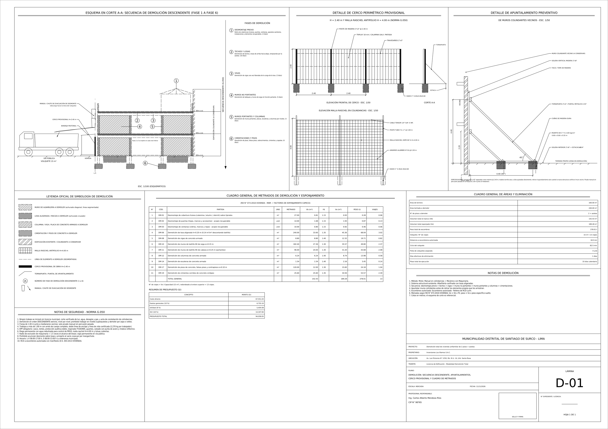
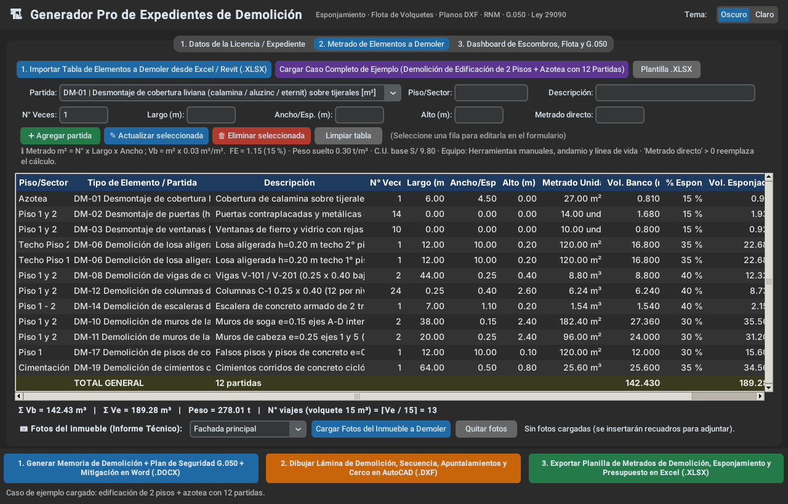
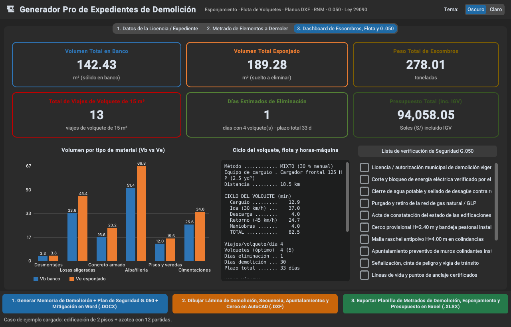

# Generador Pro de Expedientes de Demolición

Aplicación de escritorio **100 % offline** en un solo archivo (`app_demolicion_escombros_pro.py`) para elaborar expedientes de demolición en Perú:

- Metrado según el **RNM (RD N° 073-2010-VIVIENDA)** con catálogo de 21 partidas (factor de esponjamiento, peso suelto, espesor equivalente y C.U. en S/).
- Volumen en banco, volumen esponjado, peso, **N° de viajes**, **ciclo del volquete** (30 km/h cargado / 45 km/h vacío), flota y días de eliminación.
- Presupuesto (C.D., GG 10 %, utilidad 8 %, IGV 18 %), horas-máquina y cronograma por fases.
- Exporta:
  1. **Word (.docx)**: memoria descriptiva, corte de suministros, secuencia G.050, protección de vecinos, cálculo de RCD (D.S. 003-2013-VIVIENDA), Plan SST G.050, mitigación de polvo/ruido, presupuesto y anexo fotográfico (~19 páginas).
  2. **AutoCAD (.dxf)**: lámina **D-01** (A1) con capas `D-CUADROS`, `D-DETALLES`, `D-SEGURIDAD`, `D-TEXTOS`.
  3. **Excel (.xlsx)**: `1_Metrados_Demolicion_RNM`, `2_Calc_Esponjamiento_Volquetes`, `3_Presupuesto_y_Horas_Maquina`.

> Excel limita el nombre de hoja a 31 caracteres, por eso la hoja 2 se llama `2_Calc_Esponjamiento_Volquetes`.

## Instalación

```bash
pip install customtkinter openpyxl pandas ezdxf python-docx Pillow
```

```bash
python app_demolicion_escombros_pro.py
```

## Crear ejecutable (.exe)

```bash
pip install pyinstaller
```

```bash
pyinstaller --noconfirm --onefile --windowed --name "GeneradorDemolicionPro" --collect-all customtkinter --collect-all ezdxf --collect-data docx app_demolicion_escombros_pro.py
```

## Importar desde Excel / Revit

Columnas reconocidas (en cualquier orden): `Piso/Sector`, `Tipo de Elemento / Partida` (código `DM-xx` o texto), `Descripción`, `N° Veces`, `Largo (m)`, `Ancho/Espesor (m)`, `Alto (m)` y opcionalmente `Metrado Directo` / `Volumen` / `Área`. El botón **Plantilla .XLSX** genera un ejemplo.

## Vistas



| Metrado | Dashboard |
|---|---|
|  |  |
